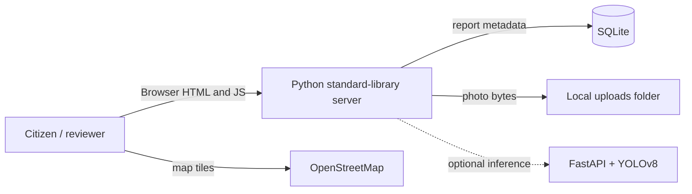

# RoadWatch

## Simplest local run: Python-only website

The recommended version for this computer is the lightweight Python server in app.py with its website in python-web/. It uses only Python's built-in libraries and SQLite: no Java, Maven, Node.js, npm, Docker, PostgreSQL, or pip packages are needed. Python 3.11 or newer is the only runtime prerequisite.

Python is not currently installed or available in PATH on this computer, so the project cannot be launched here yet. Download Python from https://www.python.org/downloads/windows/ and, during setup, select Add python.exe to PATH. Close and reopen VS Code after installation.

From the RoadWatch folder, run:

    .\run-roadwatch.bat

The browser will open at http://127.0.0.1:8000. To verify Python first, run:

    powershell -ExecutionPolicy Bypass -File .\check-setup.ps1

The Python server saves data in roadwatch.sqlite3 and photos in uploads/. It groups reports within 30 metres, records status changes in an audit trail, and serves the report form, map, and admin dashboard. The admin key defaults to change-this-admin-key. To change it for one session:

    $env:ADMIN_API_KEY='your-local-admin-key'
    .\run-roadwatch.bat

AI results remain unavailable until a separately configured compatible inference service and trained weights exist. The site makes no fake detections. The map uses Leaflet and OpenStreetMap tiles from their public websites, so map tiles require internet access.

The earlier Java/React/PostgreSQL folders and Docker Compose files are retained as the original multi-service scaffold. They are not required for this Python-only run path.

RoadWatch is a student prototype for photo-based road damage reporting and triage. It combines citizen-submitted photos, an optional location, an AI-generated suggestion, duplicate grouping, and human review.

> **Academic prototype notice:** RoadWatch is an academic prototype. It does not replace professional road inspection, emergency services, or official civic complaint systems.

AI output is a suggestion requiring human review. It does not measure pothole depth, road safety, or repair urgency. Location is optional; obtain consent before capturing it. Avoid faces, license plates, house numbers, and private property details in uploaded images. Do not stop in traffic to take a photo.

## Architecture



### Repository layout

- `app.py` — Python standard-library web server, SQLite API, validation, duplicate grouping, admin authorization, and audit records.
- `python-web/` — static website served by app.py; no Node.js build is required.
- `run-roadwatch.bat` and `check-setup.ps1` — Windows launcher and Python prerequisite checker.
- `backend/` — original Java 17 / Spring Boot 3 API scaffold.
- `ml-service/` — FastAPI inference service, YOLO model hook, data preparation, training, and evaluation scripts.
- `frontend/` — responsive React/Vite pages for Home, Report, Live Map, Admin, and Project Documentation.
- `docker-compose.yml` — local PostgreSQL, inference service, API, and frontend.
- `.env.example` — local configuration template; copy it to `.env` and replace the sample secrets.

The Python local MVP stores image files on the local filesystem and report metadata in SQLite. The retained Java MVP stores image files on a mounted local filesystem volume and uses PostgreSQL in Docker Compose. Neither local implementation is intended for public production use.

## Run locally with Docker Compose

Requirements: Docker Desktop with Compose v2. From the repository root:

```powershell
Copy-Item .env.example .env
docker compose up --build
```

Open:

- Frontend: http://localhost:5173
- Spring API: http://localhost:8080/api
- Swagger UI: http://localhost:8080/swagger-ui.html
- ML health: http://localhost:8001/health
- PostgreSQL: localhost:5432

The default setup is for local student development. Change `POSTGRES_PASSWORD` and `ADMIN_API_KEY` in `.env` before sharing the environment. Admin operations pass the configured key using `X-Admin-Key`; the included key is not an identity provider and is not suitable for public production access.

## Run without Docker

If Docker is unavailable, use the embedded H2 database for a local demo. This profile does not require PostgreSQL. Install Java 17, Maven, and Node.js 20+, then open **two PowerShell terminals** in the project folder.

To check whether the required tools are on your PATH, run `powershell -ExecutionPolicy Bypass -File .\check-setup.ps1` from the project root. It reports any missing tools and provides their official download pages. Restart VS Code after installing them so its integrated terminal refreshes PATH.

Terminal 1 — API with local H2 storage:

```powershell
cd backend
$env:SPRING_PROFILES_ACTIVE='local'
$env:ADMIN_API_KEY='change-this-admin-key'
mvn spring-boot:run
```

Terminal 2 — frontend:

```powershell
cd frontend
npm install
$env:VITE_API_URL='http://localhost:8080/api'
npm run dev
```

Open http://localhost:5173. The H2 database is saved under `backend/data/`; uploaded images are saved under `backend/uploads/`. The frontend, report API, admin review, map, and audit trail work without Docker. AI suggestions are omitted unless you separately install and start the Python inference service; without `models/best.pt`, the inference service reports that weights are unavailable and returns no detection. The H2 profile is for local development; Docker Compose continues to use PostgreSQL.

### Run services separately

Start PostgreSQL with `docker compose up -d db`, then launch the services in separate terminals:

```powershell
cd backend
$env:DB_HOST='localhost'; $env:POSTGRES_DB='roadwatch'; $env:POSTGRES_USER='roadwatch'; $env:POSTGRES_PASSWORD='change-me'
$env:ML_SERVICE_URL='http://localhost:8001'; $env:UPLOAD_DIR='../uploads'; $env:ADMIN_API_KEY='change-this-admin-key'
mvn spring-boot:run
```

```powershell
cd ml-service
python -m venv .venv
.\.venv\Scripts\Activate.ps1
pip install -r requirements.txt
uvicorn app.main:app --reload --port 8001
```

```powershell
cd frontend
npm install
$env:VITE_API_URL='http://localhost:8080/api'
npm run dev
```

## API overview

| Method | Path | Purpose |
|---|---|---|
| `POST` | `/api/reports` | Multipart upload fields: `image` (required), `latitude`, `longitude`, `note` (optional). Supply both coordinates or neither. |
| `GET` | `/api/map/reports` | Accepted reports with coordinates for the map. |
| `GET` | `/api/admin/reports` | List all reports newest first; requires `X-Admin-Key`. |
| `GET` | `/api/admin/issues` | Grouped issue list; requires `X-Admin-Key`. |
| `GET` | `/api/admin/stats` | Basic counts; requires `X-Admin-Key`. |
| `PATCH` | `/api/admin/reports/{id}/status` | Set report status; requires `X-Admin-Key`. |
| `GET` | `/api/admin/reports/{id}/audit` | Read audit events; requires `X-Admin-Key`. |
| `POST` | `/detect` | FastAPI image inference multipart field `file`. |
| `GET` | `/health` | FastAPI status and model availability. |
| `GET` | `/h2-console` | H2 browser console, enabled only with the `local` Spring profile. |

Valid report statuses: `SUBMITTED`, `AI_FLAGGED`, `UNDER_REVIEW`, `ACCEPTED`, `REJECTED`, `REPAIRED`. The duplicate grouping radius is `DUPLICATE_RADIUS_METERS` (default 30 m). Invalid or unavailable model responses do not block a report; the report remains stored without an AI suggestion. Uploads are limited to JPEG, PNG, or WebP and 10 MB.

### Sample requests

```bash
curl -F "image=@road.jpg" -F "latitude=19.0760" -F "longitude=72.8777" -F "note=Near the bus stop" http://localhost:8080/api/reports
curl -H "X-Admin-Key: change-this-admin-key" http://localhost:8080/api/admin/reports
curl http://localhost:8001/health
curl -H "X-Admin-Key: change-this-admin-key" http://localhost:8080/api/admin/stats
curl -X PATCH -H "Content-Type: application/json" -H "X-Admin-Key: change-this-admin-key" -d '{"status":"UNDER_REVIEW"}' http://localhost:8080/api/admin/reports/1/status
curl -F "file=@road.jpg" http://localhost:8001/detect
```

Swagger documents the Java API at `/swagger-ui.html`.

## Model and data preparation

The repo does not bundle RDD2022 images, annotations, or trained weights. Fetch and follow the dataset's terms and citation at [RDD2022 on Figshare](https://figshare.com/articles/dataset/RDD2022_-_The_multi-national_Road_Damage_Dataset_released_through_CRDDC_2022/21431547). Use the India subset. Organize its selected image files and VOC XML annotations into paths you pass to the converter. RDD2022's source class names may need mapping to the four target names in `prepare_data.py`; inspect annotation labels and map only genuinely equivalent classes before training.

From `ml-service/`, with Ultralytics dependencies installed:

```bash
python scripts/prepare_data.py --images /path/to/India/images --annotations /path/to/India/annotations --output data/roadwatch
python scripts/train.py
python scripts/evaluate.py --weights models/best.pt --data data/roadwatch.yaml
```

`prepare_data.py` shuffles paired images and annotations with a fixed seed into 70% train, 15% validation, 15% held-out test partitions and writes `data/roadwatch.yaml`. It converts VOC boxes to normalized YOLO boxes for class IDs longitudinal crack, transverse crack, alligator crack, and pothole. Make sure annotations actually use these class names or adapt the explicit mapping. `train.py` fine-tunes pretrained `yolov8n.pt` for 30 epochs at 640 pixels and copies the best checkpoint to `models/best.pt`. Place trained weights there before rebuilding/restarting the inference container.

`evaluate.py` evaluates only Ultralytics' test split and reports mAP@0.5, mAP@0.5:0.95, per-class precision/recall, and the confusion matrix. Keep test images out of training and validation. Results are not included because no dataset or trained checkpoint ships with this prototype.

## Workflow evaluation

`ml-service/scripts/workflow_metrics.py` computes acceptance rate, median review time, and share of reports with an image and location from a manually exported CSV. Duplicate grouping precision/recall require manually labeled true groups and pairwise comparison with predicted `duplicate_group` values; collect that labeled set before reporting a score. Do not interpret the 30 m grouping rule itself as an evaluated model. Record review labels, status changes, timestamps, and location usability consistently, and report the sample size with metrics.

## Tests

```bash
cd backend && mvn test
cd ../ml-service && pip install -r requirements.txt && pytest
```

The Java unit tests cover Haversine distance. Python tests cover health and invalid file type responses. Extend these with PostgreSQL-backed integration cases before deployment.

## Deployment notes

For a student demo, deploy the frontend as a static site and the Spring API, FastAPI service, and PostgreSQL as separate services on Render or Railway. Configure the same environment variables in the platform dashboard, use persistent storage for uploaded photos, and point the API's `ML_SERVICE_URL` to the private inference service URL. Use a managed PostgreSQL database and restrict database network access. Model files can be stored in the ML image or mounted from durable storage. Hugging Face Spaces can host the FastAPI inference demo, but keep the API private or add authentication before exposing it; its filesystem may be ephemeral. Enable HTTPS and replace the shared admin API key with real authenticated role-based access before any public or operational use. No paid mapping key is required; follow OpenStreetMap tile usage policy and attribution requirements.

## Known prototype boundaries

- Admin authentication is a shared API key for local demonstration, not citizen/admin identity management. No production access control or account registration is included.
- Missing weights are handled as unavailable and no fake detection is produced.
- Local filesystem image storage and JPA schema auto-update are development conveniences.
- Duplicate association uses Haversine distance and the nearest issue within the configured radius; damage type is not used to make location grouping an assertion that two reports describe the same physical defect.
- Metrics require collected, reviewed data; none are fabricated or claimed here.
